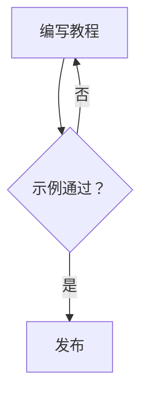
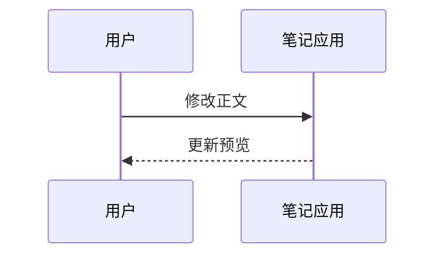
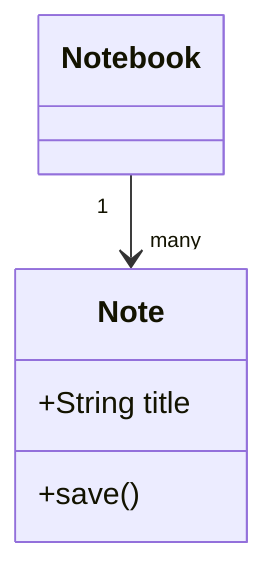
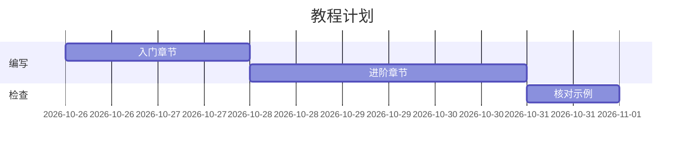
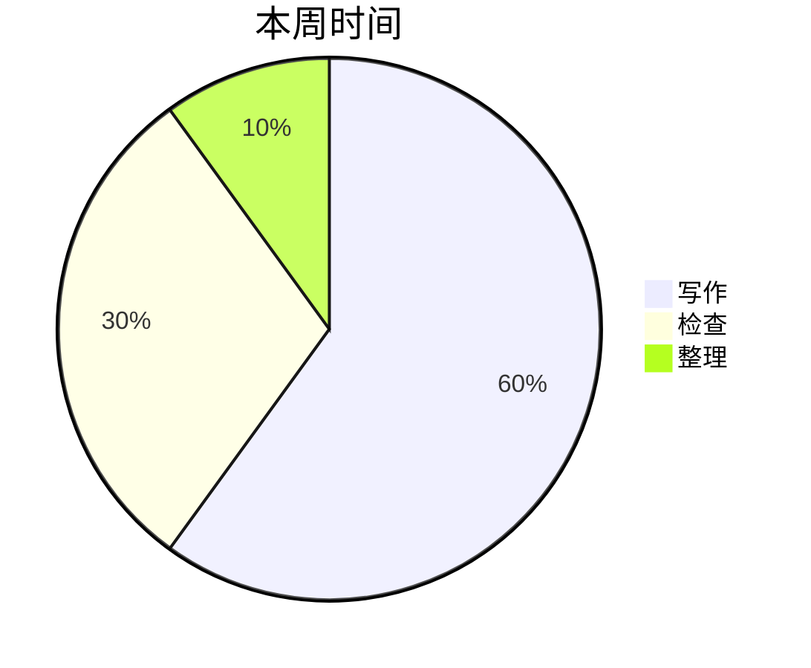
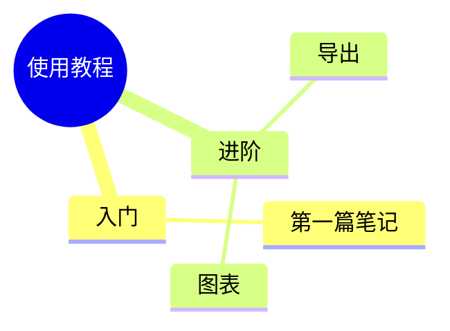
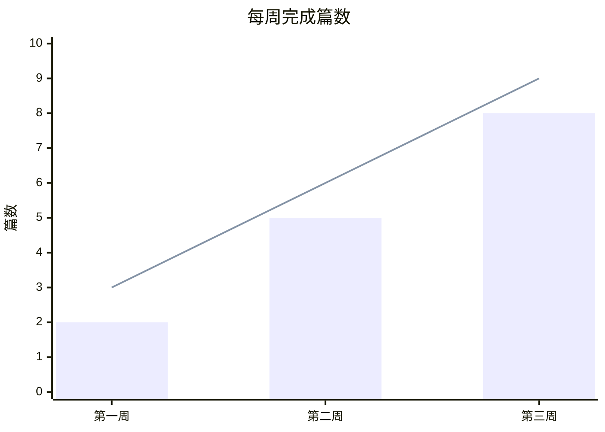
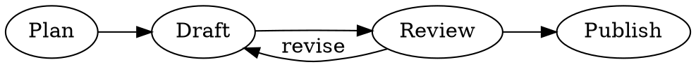
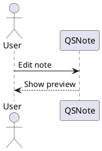

# 公式与图表

[教程目录](README.md) · 上一篇：[Markdown 编辑](editing.md) · 下一篇：[待办清单](todo.md)

新建“技术笔记”，依次粘贴本篇示例并切换“分屏”。代码框内的三反引号和语言名也要复制，它们决定如何渲染。编辑器设置的 Markdown 页可分别开启公式和图表就地预览。

## 1. 行内公式与公式块

行内公式用一对 `$`，独立公式用 `$$`：

```markdown
圆的面积为 $S=\pi r^2$。

$$
\frac{1}{n}\sum_{i=1}^{n} x_i
$$
```

预期结果：圆面积公式嵌在文字中，平均值公式独占一块。也可从工具栏“行内公式”“公式块”插入。

多行推导可以使用 KaTeX 支持的环境：

```markdown
$$
\begin{aligned}
(a+b)^2 &= a^2+2ab+b^2 \\
(a-b)^2 &= a^2-2ab+b^2
\end{aligned}
$$
```

兼容已有笔记时，还支持 `\(...\)`、`\[...\]` 及标为 `mathjax` 的代码块。`mathjax` 块实际也由 KaTeX 渲染：

````markdown
```mathjax
E=mc^2
```
````

公式在本地排版，不是完整的 LaTeX 编译环境；遇到不支持的命令，应简化表达式。导出或站点生成采用严格渲染，错误公式可能阻止生成，应先在预览修正。

## 2. Mermaid：从流程到项目计划

工具栏“更多 Markdown 语法”提供流程图、时序图、类图、甘特图、饼图、脑图、坐标轴图和数字时序图模板。前七种使用 Mermaid，最后一种使用 WaveDrom。点击模板后修改节点文字或数值即可。

### 流程图

````markdown

````

预期结果：从“编写教程”进入判断，成功到“发布”，失败回到写作。

### 时序图

````markdown

````

预期结果：两条参与者生命线和两条消息箭头，适合描述请求与响应。

### 类图

````markdown

````

预期结果：Notebook 与 Note 的关系，以及 Note 的属性和方法。

### 甘特图

````markdown

````

预期结果：任务按日期和依赖形成时间条。修改 `2d` 为 `4d` 后，后续任务随之移动；这是图中的计划展示，不会创建 Todo 事项。

### 饼图

````markdown

````

预期结果：三部分比例分别为 60%、30%、10%。

### 脑图

````markdown

````

预期结果：“使用教程”为中心，缩进决定分支层级。

### 坐标轴图

````markdown

````

预期结果：同一坐标系中显示三组柱形数值和折线数值。

## 3. Flowchart：步骤式流程图

Flowchart 使用单独的语法和 `flowchart`（或 `flow`）语言标记，不是 Mermaid 里的 `flowchart TD`：

````markdown
```flowchart
st=>start: Start
write=>operation: Write
check=>condition: Ready?
finish=>end: Publish
st->write->check
check(yes)->finish
check(no)->write
```
````

预期结果：开始、操作、判断、结束四种节点；`yes` 和 `no` 决定分支。先用短标签确认语法，再改成自己的流程文字。

## 4. Graphviz：关系网络

````markdown

````

预期结果：从左到右显示节点，并有从 Review 返回 Draft 的边。

`dot` 和 `graphviz` 使用 dot 布局；还识别 `neato`、`twopi`、`circo`、`fdp`、`sfdp`、`osage`、`patchwork`。例如把语言名改为 `circo`，可比较同一关系图的环形布局。此类代码块由内置浏览器运行库渲染，不需要系统 `dot` 命令；PlantUML 的部分图形另需本地 Graphviz。

## 5. WaveDrom：数字信号时序

````markdown
```wavedrom
{
  "signal": [
    { "name": "clk", "wave": "p......." },
    { "name": "valid", "wave": "0.1..0.." },
    { "name": "data", "wave": "x.==.x..", "data": ["A", "B"] }
  ]
}
```
````

预期结果：时钟、有效位和数据三行波形，数据区域标注 A、B。也可使用 `wave` 语言名。内容必须是合法 JSON，字符串用双引号，不要加入注释或末尾多余逗号。

## 6. PlantUML：本地渲染 UML

````markdown

````

预期结果：生成参与者和消息组成的时序图；`puml` 也是有效语言名。PlantUML 使用本机运行环境，安装步骤见 [BUILD.md](../BUILD.md)。

- Linux/macOS：需要可执行的 `plantuml`；部分图形还依赖 Graphviz。macOS 额外查找 `/opt/homebrew/bin`、`/usr/local/bin`。
- Windows：若安装包带有 PlantUML JAR，仍需 Java 在 `PATH` 中，或正确设置 `JAVA_HOME`；未带运行库时需要可用的 `plantuml` 命令。Graphviz 可由包内运行库或系统 `dot` 提供。

外部 `!include` 或其他外部资源是否可用取决于本地环境。为了迁移和离线阅读，先使用自包含示例。

## 7. 预览与导出检查

1. 一次只插入一个示例，先确认预览出现图形。
2. 修改一处节点或公式，等待预览刷新，确认修改生效。
3. 依照[导出教程](ebook-export.md)导出 HTML 或 EPUB，打开后检查图形与公式。

| 现象 | 检查方法 |
| --- | --- |
| 只显示代码 | 检查语言名、成对的反引号；编辑模式还需启用相应就地预览 |
| 显示渲染错误 | 先粘贴完整的最小示例，逐步添加自己的语句 |
| PlantUML 提示命令缺失 | 检查 Java、PlantUML、Graphviz 及应用能看到的 PATH，安装后重启应用 |
| 预览能阅读但导出失败 | 查看报错对应的公式或图表，导出/站点生成对渲染错误检查更严格 |
| 离线图片不显示 | 图表运行库是本地资源，但正文引用的远程图片仍需网络 |
