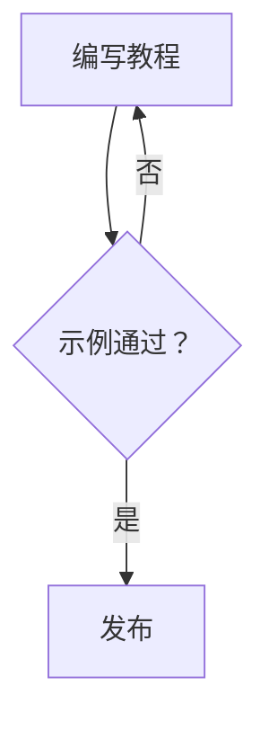
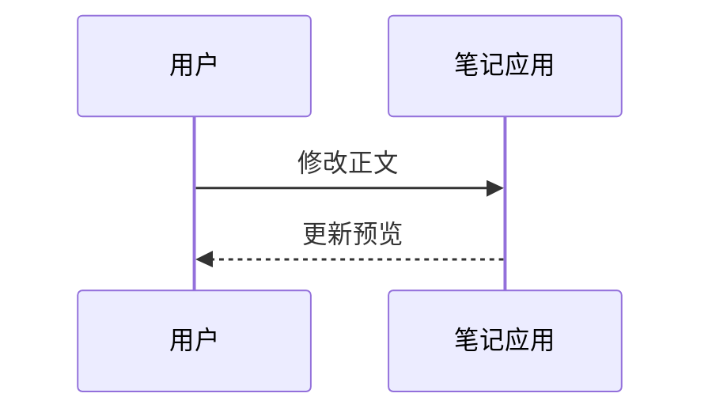
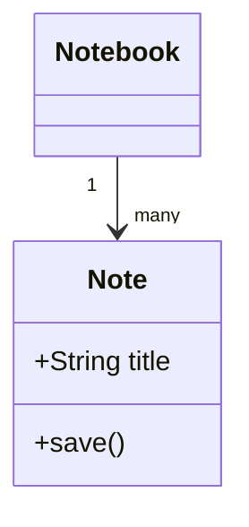
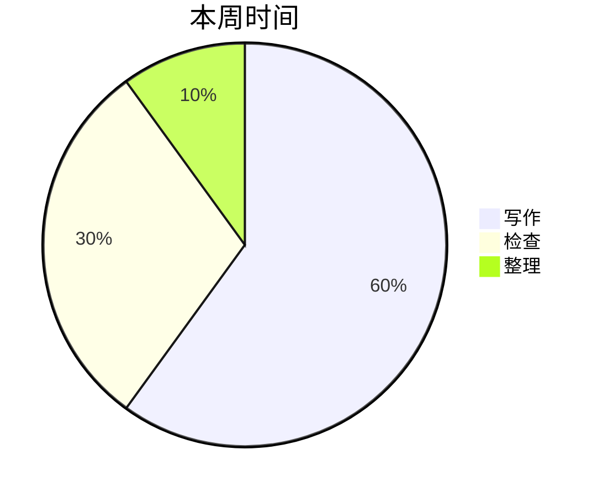
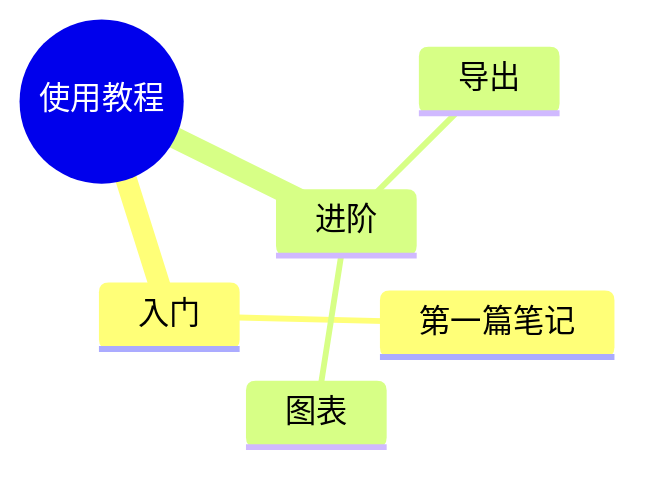
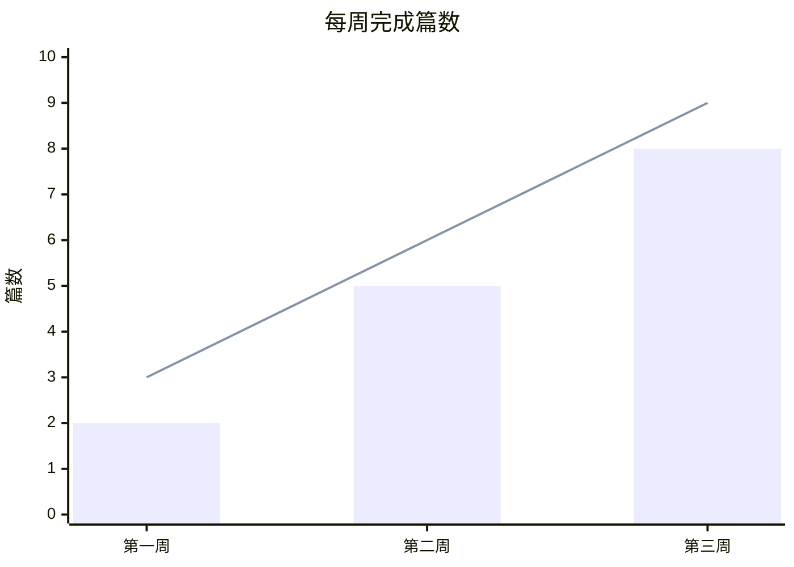
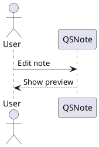

# 公式与图表

[教程目录](README.md) · 上一篇：[Markdown 编辑](editing.md) · 下一篇：[待办清单](todo.md)

新建“技术笔记”，依次粘贴本篇示例并切换“分屏”。代码框内的三反引号和语言名也要复制，它们决定如何渲染。编辑器设置的 Markdown 页可分别开启公式和图表就地预览。

## 1. 行内公式与公式块

行内公式用一对 `$`，独立公式用 `$$`：

```markdown
圆的面积为 $S=\pi r^2$。

$$
\frac{1}{n}\sum_{i=1}^{n} x_i
$$
```

预期结果：圆面积公式嵌在文字中，平均值公式独占一块。也可从工具栏“行内公式”“公式块”插入。

多行推导可以使用 KaTeX 支持的环境：

```markdown
$$
\begin{aligned}
(a+b)^2 &= a^2+2ab+b^2 \\
(a-b)^2 &= a^2-2ab+b^2
\end{aligned}
$$
```

兼容已有笔记时，还支持 `\(...\)`、`\[...\]` 及标为 `mathjax` 的代码块。`mathjax` 块实际也由 KaTeX 渲染：

````markdown
```mathjax
E=mc^2
```
````

公式在本地排版，不是完整的 LaTeX 编译环境；遇到不支持的命令，应简化表达式。导出或站点生成采用严格渲染，错误公式可能阻止生成，应先在预览修正。

## 2. 图表模板

在工具栏的“更多 Markdown 语法”中选择模板，即可插入对应的代码块。脑图可以用 Mermaid 的缩进语法，也可以用 Markmap 的 Markdown 标题和列表。

### 流程图

````markdown

````

预期结果：从“编写教程”进入判断，成功到“发布”，失败回到写作。

### 时序图

````markdown

````

预期结果：两条参与者生命线和两条消息箭头，适合描述请求与响应。

### 类图

````markdown

````

预期结果：Notebook 与 Note 的关系，以及 Note 的属性和方法。

### 甘特图

````markdown

````

预期结果：任务按日期和依赖形成时间条。修改 `2d` 为 `4d` 后，后续任务随之移动；这是图中的计划展示，不会创建 Todo 事项。

### 饼图

````markdown

````

预期结果：三部分比例分别为 60%、30%、10%。

### 脑图

````markdown

````

预期结果：“使用教程”为中心，缩进决定分支层级。

### Markmap 思维导图

在“更多 Markdown 语法”里选择“Markmap 思维导图”，或手动输入下面的围栏。标题和嵌套列表决定分支层级。

````markdown
```markmap
# 项目计划

## 需求
- 用户调研
  - 访谈
  - 问卷

## 开发
- 编码
- 测试
```
````

阅读预览中，鼠标停在导图上时，滚轮仍会上下滚动文章。可以用鼠标拖动导图，点击分支节点折叠或展开。编辑区内嵌预览和导出使用静态图。

### 坐标轴图

````markdown

````

预期结果：同一坐标系中显示三组柱形数值和折线数值。

## 3. Flowchart：步骤式流程图

Flowchart 使用单独的语法和 `flowchart`（或 `flow`）语言标记，不是 Mermaid 里的 `flowchart TD`：

````markdown
```flowchart
st=>start: Start
write=>operation: Write
check=>condition: Ready?
finish=>end: Publish
st->write->check
check(yes)->finish
check(no)->write
```
````

预期结果：开始、操作、判断、结束四种节点；`yes` 和 `no` 决定分支。先用短标签确认语法，再改成自己的流程文字。

## 4. Graphviz：关系网络

````markdown

````

预期结果：从左到右显示节点，并有从 Review 返回 Draft 的边。

`dot` 和 `graphviz` 使用 dot 布局；还识别 `neato`、`twopi`、`circo`、`fdp`、`sfdp`、`osage`、`patchwork`。例如把语言名改为 `circo`，可比较同一关系图的环形布局。此类代码块由内置浏览器运行库渲染，不需要系统 `dot` 命令；PlantUML 的部分图形另需本地 Graphviz。

## 5. WaveDrom：数字信号时序

````markdown
```wavedrom
{
  "signal": [
    { "name": "clk", "wave": "p......." },
    { "name": "valid", "wave": "0.1..0.." },
    { "name": "data", "wave": "x.==.x..", "data": ["A", "B"] }
  ]
}
```
````

预期结果：时钟、有效位和数据三行波形，数据区域标注 A、B。也可使用 `wave` 语言名。内容必须是合法 JSON，字符串用双引号，不要加入注释或末尾多余逗号。

## 6. PlantUML：本地渲染 UML

````markdown

````

预期结果：生成参与者和消息组成的时序图；`puml` 也是有效语言名。PlantUML 使用本机运行环境，安装步骤见 [BUILD.md](../BUILD.md)。

- Linux/macOS：需要可执行的 `plantuml`；部分图形还依赖 Graphviz。macOS 额外查找 `/opt/homebrew/bin`、`/usr/local/bin`。
- Windows：若安装包带有 PlantUML JAR，仍需 Java 在 `PATH` 中，或正确设置 `JAVA_HOME`；未带运行库时需要可用的 `plantuml` 命令。Graphviz 可由包内运行库或系统 `dot` 提供。

外部 `!include` 或其他外部资源是否可用取决于本地环境。为了迁移和离线阅读，先使用自包含示例。

## 7. 预览与导出检查

1. 一次只插入一个示例，先确认预览出现图形。
2. 修改一处节点或公式，等待预览刷新，确认修改生效。
3. 依照[导出教程](ebook-export.md)导出 HTML 或 EPUB，打开后检查图形与公式。

| 现象 | 检查方法 |
| --- | --- |
| 只显示代码 | 检查语言名、成对的反引号；编辑模式还需启用相应就地预览 |
| 显示渲染错误 | 先粘贴完整的最小示例，逐步添加自己的语句 |
| PlantUML 提示命令缺失 | 检查 Java、PlantUML、Graphviz 及应用能看到的 PATH，安装后重启应用 |
| 预览能阅读但导出失败 | 查看报错对应的公式或图表，导出/站点生成对渲染错误检查更严格 |
| 离线图片不显示 | 图表运行库是本地资源，但正文引用的远程图片仍需网络 |

## 函数绘图（plot）

工具栏“更多 Markdown 语法” → “函数绘图（plot）”可插入简洁的函数绘图代码块。每行写一个关于 `x` 的表达式，最多八条曲线：

~~~markdown
```plot
title: 三角函数
x: -2*pi..2*pi
y: -2..2
height: 300
sin(x) # 正弦
cos(x) # 余弦
```
~~~

图表采用深蓝渐变背景、亮色圆角曲线与柔光，图例显示为彩色圆角标签；就地预览和导出保留相同样式。

`title` 设置标题，`x`、`y` 用 `最小值..最大值` 设置坐标范围，范围端点可用 `pi` 等常数表达式。省略范围或设为 `auto` 时，横轴默认为 `[-8, 8]`，纵轴根据采样值自动估算。`height` 默认为 300，限制在 200–560 像素之间，图例附加在图形下方。空行及以 `//` 开头的注释行会被忽略；表达式后的 `#` 设置曲线标签。

支持 `+ - * / % ^`（`**` 也表示乘方），以及 `2x`、`2sin(x)`、`(x+1)(x-1)` 这样的隐式乘法。`-x^2` 表示 `-(x^2)`，乘方从右向左结合。常数包括 `pi`（或 `π`）、`e`、`tau` 和 `phi`。支持三角函数及反三角函数、双曲函数及其反函数、`sec/csc/cot`、`sqrt/cbrt/abs/exp`、`floor/ceil/round/sign`、`min/max/pow/atan2/mod`；`ln` 为自然对数，`log` 和 `log10` 为常用对数，另有 `log2`。三角函数使用弧度。

阅读预览默认关闭绘图交互，鼠标位于图中时滚轮仍滚动文章。就地预览、导出和生成站点使用静态图片。无定义点和检测到的渐近线会断开绘制；图像采用数值采样，自动范围可能裁掉极值，可手动设置范围。错误输入保留代码并提示行号，导出前需修正。

解析回归检查：在仓库根目录执行 `node tests/simple-plot.test.cjs`。

绘图回归检查：用浏览器打开 `tests/simple-plot.html`，页面应显示 PASS，覆盖默认关闭交互、滚轮透传、断点、旧语法和 PNG 转换。

## 函数绘图（function-plot）

在编辑器工具栏点击“更多 Markdown 语法” → “函数绘图（function-plot）”，即可插入示例。代码块语言名为 `function-plot`。

使用离线打包的 function-plot 1.26.0，配置支持 JSON 和 [JSON5](https://json5.org/)（无引号键名、单引号、注释及尾逗号），不支持 JavaScript 回调或表达式求值；数学公式仍写在 fn 字符串中。

~~~markdown
```function-plot
{
  "grid": true,
  "xAxis": {"label": "x", "domain": [-6, 6]},
  "yAxis": {"label": "y", "domain": [-2, 2]},
  "data": [{"fn": "sin(x)"}, {"fn": "cos(x)"}]
}
```
~~~

阅读预览默认关闭绘图交互，鼠标位于图中时滚轮仍滚动文章。如需缩放和平移，可在配置顶层显式设置 `disableZoom: false`；修改源码后恢复初始范围。就地预览、文档导出和生成站点为静态图片，按源码配置渲染。默认高度 400，可使用正数 width、height 设置尺寸；窄窗口按比例显示。target、id 及插件由应用管理。错误配置在预览中提示，导出时报错。

直接复制官方配置对象也可以，例如：

~~~markdown
```function-plot
{
  target: '#domain',
  yAxis: { label: 'y', domain: [-1, 1] },
  xAxis: { label: 'x', domain: [8, 24] },
  data: [{ fn: 'sin(x)' }]
}
```
~~~

配置中的 target 会被忽略，由应用指定绘图容器，无需创建 #domain 元素。也兼容复制示例时对象闭括号后的一个逗号；代码块中只放配置对象，不要包含 functionPlot(...) 调用。

解析回归检查：在仓库根目录执行 `node tests/plot.test.cjs`。

滚轮交互回归检查：用浏览器打开 `tests/plot-interaction.html`，页面应显示 PASS。

## Python / matplotlib 绘图（pyplot）

`pyplot` 代码块执行真实 Python，适合 NumPy 数据分析和 matplotlib 图表。普通 `python` 代码块仍然只显示源码。也可从“更多 Markdown 语法”插入 Python 绘图示例。

### 环境和全局开关

在“设置 → Python 绘图”选择 Python 3 解释器；留空时从系统 PATH 查找 `python3`，再查找 `python`。虚拟环境应选择其中的 `bin/python`（Windows 为 `Scripts/python.exe`）。显式指定的路径无效时会报错，不切换到其他环境。

点击“检查 Python 环境”检查版本及 matplotlib、NumPy。缺少依赖时，使用检查结果中的命令安装，例如：

```sh
"/path/to/venv/bin/python" -m pip install matplotlib numpy
```

应用不会自动安装依赖。Windows 命令提示符可使用同样的带引号形式；PowerShell 需要在带引号的解释器路径前加 `&`。

在“设置 → Python 绘图”中勾选“启用 Python 绘图”即可全局启用，默认关闭，无需逐笔记本授权或风险确认。开关仅保存在本机，立即生效，不受设置页“取消”影响。关闭会停止正在运行的绘图并清空预览结果。未启用时保留源码，导出会明确提示先启用。不属于已登记笔记本的外部 Markdown 文件仍不执行 Python。

代码块禁止直接导入 `os`、`sys`、`posix`、`nt`、`subprocess`、`ctypes` 和 `multiprocessing`，包括 `from ... import ...` 和直接调用 `__import__()`。matplotlib、NumPy 等库自身的内部导入不受影响，可继续读取相对路径下的 CSV。这只是直接导入限制，不是 Python 沙箱。

### 示例与执行规则

````markdown
```pyplot
import numpy as np
import matplotlib.pyplot as plt

x = np.linspace(0, 2 * np.pi, 200)
fig, axes = plt.subplots(1, 2, figsize=(8, 3))
axes[0].plot(x, np.sin(x))
axes[1].plot(x, np.cos(x))
fig.tight_layout()
plt.show()
```
````

每块在新进程中独立运行，变量不能跨块共享，依赖需自行导入。显示最后创建且未关闭的 figure；该 figure 可以包含多个子图。`plt.show()` 不阻塞、不关闭图片，也可以省略。如果没有未关闭的 figure，会显示错误。

工作目录为当前笔记所在目录，预览和导出一致，因此可用 `np.loadtxt('data.csv', delimiter=',')` 读取旁边的数据文件。Python 异常包含类型和代码块内行号；单块最多运行 30 秒。编辑器内嵌预览失败时保留源码，并在工作区状态栏显示原因；独立预览会在源码旁显示原因。

使用 Agg 后端生成静态 PNG，默认 figure DPI 为 150，可用 `plt.figure(dpi=...)` 或 matplotlib 配置覆盖。字体使用本机 matplotlib 配置；中文需要在 Python 环境中配置合适的字体。预览不提供交互工具栏或动画。

预览仅缓存本次会话中的结果。修改外部 CSV 等数据文件后，点击“设置 → Python 绘图”中的“重新绘图”；它会清空会话绘图缓存并刷新两种预览。缩放窗口复用已有图片。HTML、PDF、EPUB、CHM 和静态站点导出会重新运行代码并打包 PNG，阅读端不需要 Python；绘图失败会终止导出，并报告笔记和代码块行号。CHM 仍需 Windows CHM 编译器。

开发验证：`python3 -m unittest discover -s tests -p test_pyplot.py`；进程和正文导出集成测试使用 `cmake -S tests -B build/pyplot-tests`、`cmake --build build/pyplot-tests` 和 `ctest --test-dir build/pyplot-tests --output-on-failure`。测试需要 Python 3、matplotlib、NumPy、PlantUML、Graphviz 及 Qt 6 Test/WebEngine 开发组件。


## 分层架构图（layer-arch）

从“更多 Markdown 语法 → 分层架构图”插入模板，或使用以下代码块。实现遵循 [LayerArch 1.0 语法规范](layer-arch-syntax-spec.md)，支持本地编辑器内嵌预览、阅读预览和导出。

````markdown
```layer-arch
@title 分层架构图
@theme azure
# 应用层 @color(mint)
- Web 应用 | 浏览器
- 桌面应用 | Qt
-->
# 服务层 @color(blue)
## 业务服务 @cols(2)
- 用户服务
- 笔记服务
- 业务集群 @span(2) @cols(2) @border(dashed)
  - 同步服务
  - 搜索服务
## 基础服务 @fill(soft) @border(dashed)
- 身份认证
- 消息通知
-->
# 存储层 @color(purple)
- 数据库
- 缓存 @fill(none)
```
````

- `#` 创建顶层容器。直接写 `-` 时，模块默认横向并排；直接写 `##` 时，子容器纵向排列。同一容器内的直接子项须使用同一种形式。
- `@label(left|center|right|hide)` 控制当前容器标题的左对齐、居中、右对齐或隐藏，默认居中。适用于 `#`、`##` 和带子项的 `-`。
- `- 标题 | 副标题` 创建组件。子组件每级缩进恰好两个空格，自动形成可继续嵌套的容器，禁止 Tab 缩进。
- `@cols(2)` 按两列逐行排布，`@stack` 纵向排列，二者不能同时使用。`@span(2)` 在直接父级显式声明的网格中占两列。
- `@color(blue)` 或 `@color(#B5D4F4)` 设置颜色；内置色名为 blue、mint、purple、orange、slate、gray、green、pink、yellow。`@fill(soft|solid|none)` 设置填充；颜色与填充就近继承。
- `@border(solid|dashed|none)` 分别为实线（默认）、虚线和无边框，适用于 `#`、`##` 和 `-`。容器使用 `@border(none)` 时内边距为零，子模块之间仍有间距。
- 仅单独一行、不缩进的 `-->` 连接相邻顶层区块；没有 `-->` 就没有箭头。不支持箭头标签、连续箭头或首尾箭头。
- `@title`、`@desc`、`@theme azure|light|dark` 和全局 `@color(...)` 必须放在首个 `#` 前。标题与说明写入 SVG 无障碍元数据。
- 属性仅在行尾识别。`\|` 显示字面竖线，`\@` 显示属性位置的 @，`\\` 显示反斜线；正文里的邮件地址无需转义，所有文字均按纯文本渲染。

图宽随可用空间调整；复杂嵌套会扩大图的最小宽度，阅读预览可横向滚动。文字自动换行，容器随内容增高。

旧 demo 的 `@azure`、`@solid`、`@w2`、`@ghost`、`@width`、`---`、`..>`、`==>` 等不属于 1.0，需改用上述正式语法。语法错误会显示错误代码和代码块内行号，并保留源码，不会静默丢弃组件。

开发验证：`node --test tests/layer-arch.test.cjs`。完整的投屏 SDK、多级微服务示例见语法规范第 9、10 节。
