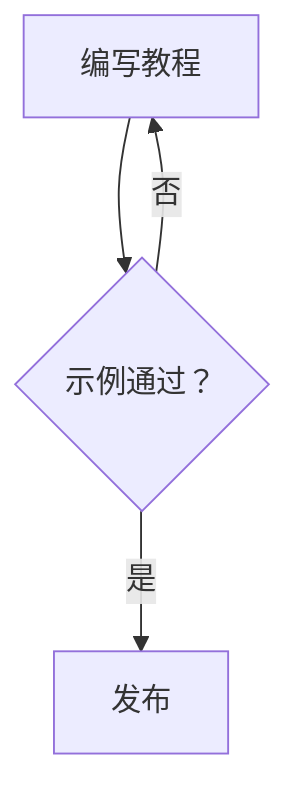
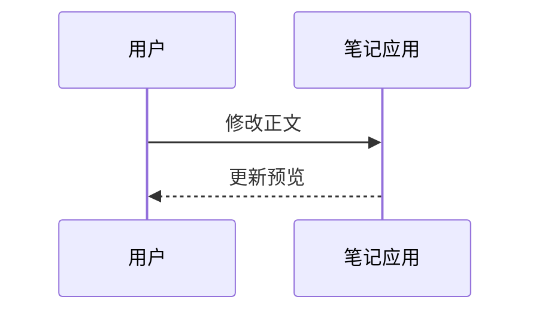
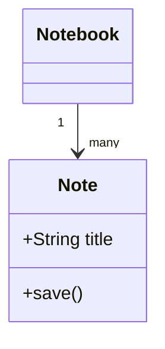
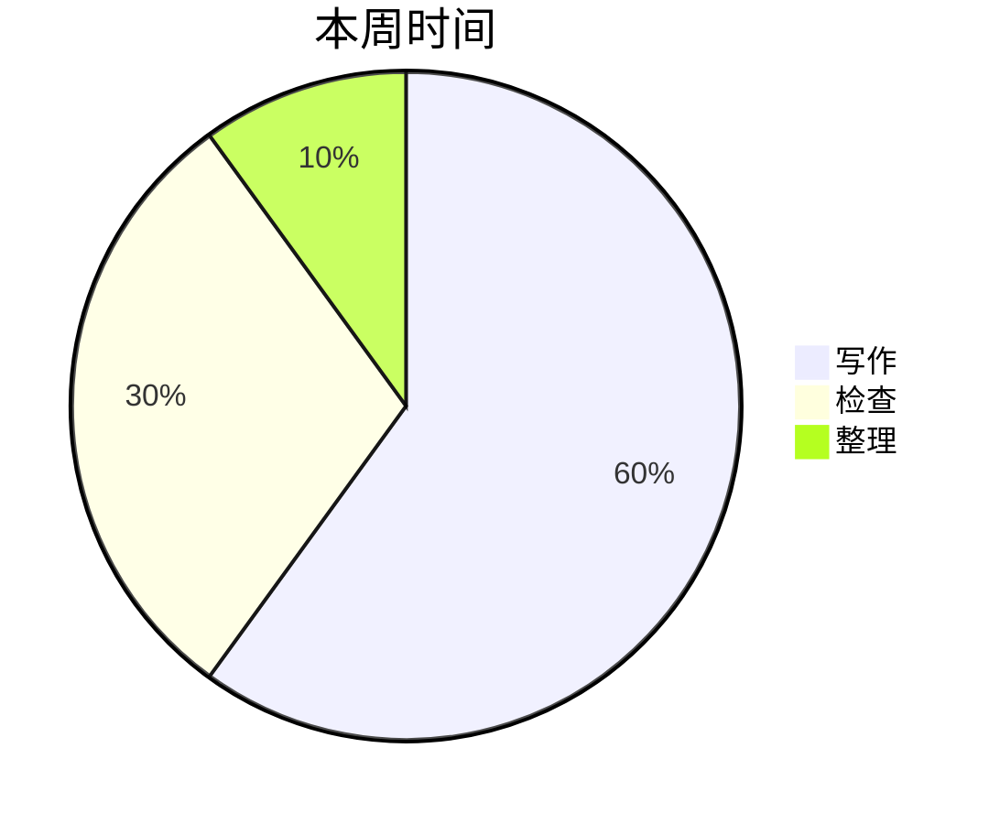
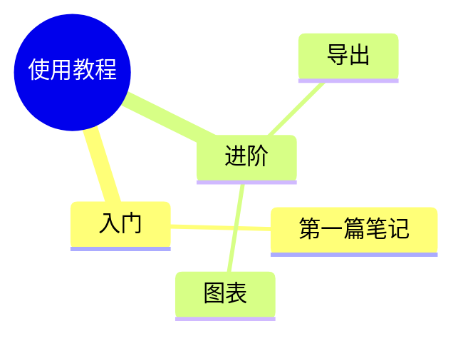
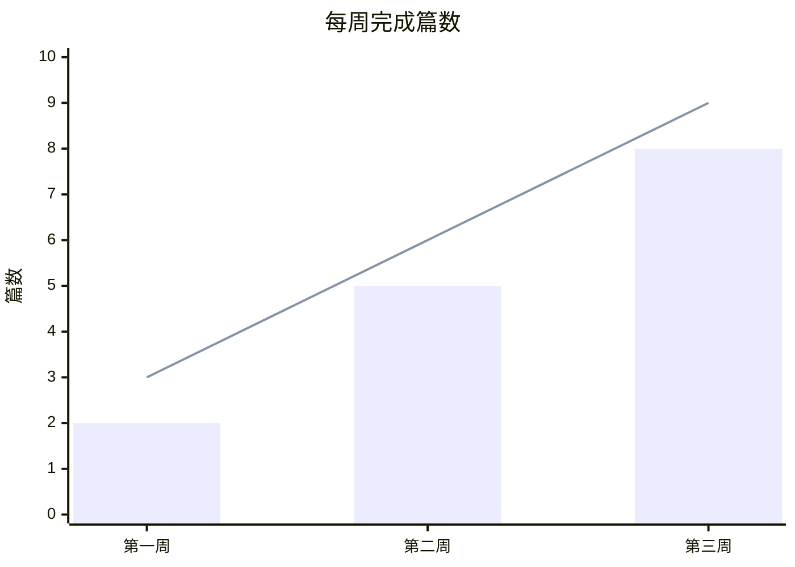
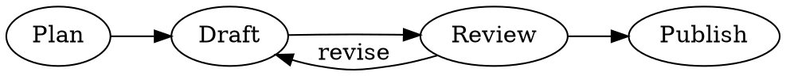
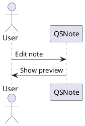

# Markdown 语法完整参考

本文以当前仓库实际实现为准，覆盖通用 Markdown、GFM 核心扩展、VTextEdit 编辑器扩展及 QSNote 阅读与站点扩展。这里的“完整”指应用支持的 Markdown 入口，不代替 Mermaid、LaTeX 或 Python 各语言手册。

每节依次给出使用场景、可复制源码和真实渲染示例。“显示效果”下面是实际 Markdown 内容，不是效果描述或截图。在 QSNote 中打开本文件并切换预览/分屏即可观看；GitHub 等阅读器不一定支持公式、容器和绘图。配色、字号由当前主题决定。图表代码框在 QSNote 中会转成图形。

VTextEdit 是编辑组件，不是独立的 Markdown 标准；编辑区高亮、就地预览和阅读区渲染是不同能力。下文按使用层次分类，不声称扩展由该项目原创。脚注、公式、表情和 GitHub Alerts 不属于 GFM 核心规范。编辑区显示图像、公式、表格和图表需要打开相应就地预览开关。


## 一、基本 Markdown 通用语法

### 1. 标题

**使用场景：** 组织文章层级和大纲。

**语法示例：**

````markdown
# 一级标题示例

## 二级标题示例

### 三级标题示例

#### 四级标题示例

##### 五级标题示例

###### 六级标题示例
````

`#` 号后留空格。示例标题也会进入本文目录。另一种 Setext 写法用下一行的 `===` 或 `---` 表示一级、二级标题。


### 2. Setext 标题

**使用场景：** 阅读或维护采用下划线标题的旧文档。

**语法示例：**

````markdown
Setext 一级示例
===

Setext 二级示例
---
````

标题前后留空行；独立的 `---` 也可能被解析为分隔线。


### 3. 段落、软换行和硬换行

**使用场景：** 区分新段落与同段内换行。

**语法示例：**

````markdown
第一段第一行，
源码换行通常仍属于同一段。

第二段第一行。  
这一行前面使用了两个行尾空格。
下一行前也可用反斜杠。\
这是硬换行后的内容。
````

**显示效果：**

第一段第一行，
源码换行通常仍属于同一段。

第二段第一行。  
这一行前面使用了两个行尾空格。
下一行前也可用反斜杠。\
这是硬换行后的内容。

空行开始新段落；上例“第二段第一行。”后有两个真实空格，复制时不要删掉。


### 4. 强调

**使用场景：** 强调术语或结论。

**语法示例：**

````markdown
*斜体*，_另一种斜体_，**粗体**，__另一种粗体__，***粗斜体***。
````

**显示效果：**

*斜体*，_另一种斜体_，**粗体**，__另一种粗体__，***粗斜体***。


### 5. 引用与嵌套引用

**使用场景：** 引用原话、摘录资料。

**语法示例：**

````markdown
> 这是引用。
>
> **引用内也支持格式。**
>
> > 这是嵌套引用。
````

**显示效果：**

> 这是引用。
>
> **引用内也支持格式。**
>
> > 这是嵌套引用。


### 6. 无序列表

**使用场景：** 记录没有先后顺序的事项。

**语法示例：**

````markdown
- 文档
- 实现
  - 编辑器
  - 预览器
````

**显示效果：**

- 文档
- 实现
  - 编辑器
  - 预览器

也可用 `*` 或 `+`；同一列表尽量保持同一种标记。


### 7. 有序列表与列表内段落

**使用场景：** 记录步骤、包含说明的任务。

**语法示例：**

````markdown
1. 打开笔记。

   在列表项内保留缩进，继续写说明。

2. 修改正文。
   - 检查格式
   - 保存文件
````

**显示效果：**

1. 打开笔记。

   在列表项内保留缩进，继续写说明。

2. 修改正文。
   - 检查格式
   - 保存文件

续行缩进对齐列表正文；显示编号由列表规则生成，源码可以统一使用 `1.`。也支持 `1)` 标记。


### 8. 分隔线

**使用场景：** 分隔文章主题。

**语法示例：**

````markdown
上半部分。

---

下半部分。
````

**显示效果：**

上半部分。

---

下半部分。

独立一行至少三个 `-`、`*` 或 `_`，例如 `***`、`___`。


### 9. 行内代码

**使用场景：** 展示命令、文件名和短代码。

**语法示例：**

````markdown
调用 `save()`；包含反引号时使用双反引号：`` `code` ``。
````

**显示效果：**

调用 `save()`；包含反引号时使用双反引号：`` `code` ``。


### 10. 围栏代码块

**使用场景：** 展示多行代码并按语言高亮。

**语法示例：**

````markdown
```cpp
int main() {
    return 0;
}
```
````

**显示效果：**

```cpp
int main() {
    return 0;
}
```

也可用 `~~~` 围栏。语言名可省略；未知语言通常只显示代码。展示含三个反引号的 Markdown 时，外层使用四个或更多反引号。普通代码块不执行代码；QSNote 的特殊绘图语言另见后文。


### 11. 缩进代码块

**使用场景：** 展示不带语言标识的纯代码。

**语法示例：**

````markdown
    first line
    second line
````

**显示效果：**

    first line
    second line

每行缩进四个空格，前面留空行；列表内需要额外缩进。


### 12. 行内链接与自动链接

**使用场景：** 引用网页、邮箱。

**语法示例：**

````markdown
[示例网站](https://example.com "链接标题")

<https://example.com>

<reader@example.com>
````

**显示效果：**

[示例网站](https://example.com "链接标题")

<https://example.com>

<reader@example.com>

标题提示是否显示由阅读器决定。链接地址含空格时可使用 `<路径>` 包住目标。


### 13. 引用式链接

**使用场景：** 复用长地址，保持正文清晰。

**语法示例：**

````markdown
访问[示例站点][syntax-site]，也可使用[syntax-site][] 或 [syntax-site]。

[syntax-site]: https://example.com "示例"
````

**显示效果：**

访问[示例站点][syntax-site]，也可使用[syntax-site][] 或 [syntax-site]。

[syntax-site]: https://example.com "示例"

定义可以放在文末；定义本身不显示。


### 14. 图片与图片链接

**使用场景：** 插入截图、示意图或可点击图片。

**语法示例：**

````markdown


[](https://example.com)
````

**显示效果：**


[](https://example.com)

示例引用仓库真实资源，离线可用。迁移本文件时需一起保留资源及相对目录。普通图片语法是 ``，也支持引用式 `![说明][图片标识]` 配合 `[图片标识]: 地址`。QSNote 独立图片的替代文字还可能成为图注。


### 15. 转义与 HTML 实体

**使用场景：** 按字面显示 Markdown 符号和特殊字符。

**语法示例：**

````markdown
\*不是斜体\*，\# 不是标题，\[不是链接\]。

&lt;tag&gt;，&amp;，&copy;。
````

**显示效果：**

\*不是斜体\*，\# 不是标题，\[不是链接\]。

&lt;tag&gt;，&amp;，&copy;。

代码块和行内代码通常无需 Markdown 转义。


### 16. 内嵌 HTML 与注释

**使用场景：** 表示键盘按键或隐藏写作备注。

**语法示例：**

````markdown
按 <kbd>Enter</kbd> 继续。<br>这是换行后的内容。

<!-- 此备注不显示 -->

可见正文。
````

**显示效果：**

按 <kbd>Enter</kbd> 继续。<br>这是换行后的内容。

<!-- 此备注不显示 -->

可见正文。

QSNote 会过滤不允许的 HTML、URL 和脚本；不能假设任意 HTML/CSS 都能保留。注释不显示是正常效果。


## 二、GFM 核心扩展

以下为常用 GFM 扩展；QSNote 使用 markdown-it 及插件实现兼容行为，并不保证每个边界条件与 GitHub 完全相同。


### 17. 表格与列对齐

**使用场景：** 对比方案、列出参数。

**语法示例：**

````markdown
| 左对齐 | 居中 | 右对齐 |
| :--- | :---: | ---: |
| **名称** | 状态 | 12 |
| 转义竖线 \| | `code` | 100 |
````

**显示效果：**

| 左对齐      |  居中  | 右对齐 |
| :---------- | :----: | -----: |
| **名称**    |  状态  |     12 |
| 转义竖线 \| | `code` |    100 |

表头和分隔行不可少；`:` 控制对齐。单元格内不能直接放普通多段落块，换行可尝试 `<br>`。


### 18. 删除线

**使用场景：** 标记废弃内容或修改痕迹。

**语法示例：**

````markdown
~~旧方案~~ 已替换为 **新方案**。
````

**显示效果：**

~~旧方案~~ 已替换为 **新方案**。


### 19. 任务列表

**使用场景：** 记录可勾选事项。

**语法示例：**

````markdown
- [ ] 编写正文
- [x] 准备示例
- [ ] 核对效果
````

**显示效果：**

- [ ] 编写正文
- [x] 准备示例
- [ ] 核对效果

方括号内使用空格或 `x`。QSNote 阅读预览中点击可回写源码；导出后的行为取决于输出形式。它与独立 Todo List 笔记本不同。


### 20. 裸地址自动链接

**使用场景：** 快速粘贴网址。

**语法示例：**

````markdown
https://example.com

reader@example.com
````

**显示效果：**

https://example.com

reader@example.com

QSNote 开启 linkify，但关闭模糊域名识别；不要依赖裸写 `example.com` 自动变成链接。


## 三、VTextEdit 编辑相关扩展及 QSNote 兼容渲染

这里集中说明编辑器识别、呈现或提供就地预览的非基础语法；阅读区由 QSNote 的渲染器完成。


### 21. 高亮标记

**使用场景：** 突出待确认内容。

**语法示例：**

````markdown
这里是 ==重点内容==。
````

**显示效果：**

这里是 ==重点内容==。


### 22. 指定图片尺寸

**使用场景：** 控制截图或图标占用空间。

**语法示例：**

````markdown

````

**显示效果：**


尺寸扩展使用 `=宽x高`；这是扩展语法，普通 Markdown 阅读器未必支持。


### 23. 字体颜色

**使用场景：** 在编辑源码时区分彩色文字。

**语法示例：**

````markdown
<font color="red">红色文字</font>，<font color="#008000">绿色文字</font>。
````

**显示效果：**

<font color="red">红色文字</font>，<font color="#008000">绿色文字</font>。

VTextEdit 对配对 `<font color=...>` 的内容着色，标签仍可见；支持颜色名和十六进制，不等于支持通用 CSS。阅读区还受 HTML 过滤和主题影响，应分别检查编辑区及预览。


### 24. 行内公式

**使用场景：** 把变量和短公式嵌入句子。

**语法示例：**

````markdown
圆面积为 $S=\pi r^2$，质能关系为 $E=mc^2$。
````

**显示效果：**

圆面积为 $S=\pi r^2$，质能关系为 $E=mc^2$。

使用 KaTeX 排版；美元符号紧贴公式内容。要显示字面美元符号可写 `\$`。


### 25. 独立公式与多行推导

**使用场景：** 展示推导过程。

**语法示例：**

````markdown
$$
\begin{aligned}
(a+b)^2 &= a^2+2ab+b^2 \\
(a-b)^2 &= a^2-2ab+b^2
\end{aligned}
$$
````

**显示效果：**

$$
\begin{aligned}
(a+b)^2 &= a^2+2ab+b^2 \\
(a-b)^2 &= a^2-2ab+b^2
\end{aligned}
$$


### 26. 公式编号与行内大公式

**使用场景：** 编号引用或在行内显示大尺寸运算符。

**语法示例：**

````markdown
$$
E=mc^2
$$ (1)

行内展示：$$\sum_{i=1}^{n}i$$。
````

**显示效果：**

$$
E=mc^2
$$ (1)

行内展示：$$\sum_{i=1}^{n}i$$。

同行双美元使用 display 风格排版，但并不一定独占一行。


### 27. 原始公式环境与 mathjax 代码块

**使用场景：** 兼容已有技术笔记。

**语法示例：**

````markdown
\begin{aligned}
x &= 1+2 \\
y &= 3+4
\end{aligned}

```mathjax
\frac{a}{b}
```
````

**显示效果：**

\begin{aligned}
x &= 1+2 \\
y &= 3+4
\end{aligned}

```mathjax
\frac{a}{b}
```

`mathjax` 是兼容语言名，实际由 KaTeX 渲染。当前 article.js 只启用 dollars/raw 分隔规则；不要把 `\(...\)`、`\[...\]` 当成阅读区的通用入口（mathjax 块内另有包装剥离）。


## 四、QSNote 阅读与站点扩展


### 28. 脚注

**使用场景：** 补充来源和解释，减少正文干扰。

**语法示例：**

````markdown
这个结论有补充说明。[^syntax-note]

也可以写行内脚注。^[这里是行内说明。]

[^syntax-note]: 这是脚注正文，可含 **强调** 和链接。
````

**显示效果：**

这个结论有补充说明。[^syntax-note]

也可以写行内脚注。^[这里是行内说明。]

[^syntax-note]: 这是脚注正文，可含 **强调** 和链接。

脚注通常集中显示在全文末尾；点击编号可跳转。


### 29. 上标和下标

**使用场景：** 写简单化学式或指数。

**语法示例：**

````markdown
水：H~2~O；平方：x^2^。
````

**显示效果：**

水：H~2~O；平方：x^2^。

复杂表达式建议使用数学公式；上下标文本中的空格需要按插件规则转义。


### 30. 表情短码

**使用场景：** 标注情绪或状态。

**语法示例：**

````markdown
:smile: :heart: :warning:
````

**显示效果：**

:smile: :heart: :warning:

可用短码取决于内置 emoji 插件；直接输入 Unicode 表情也可以。


### 31. 文内目录与标题锚点

**使用场景：** 给长文提供导航。一般放在正文前面，展示文章大纲。

**语法示例：**

````markdown
[[toc]]
````


### 32. 提示容器

**使用场景：** 突出操作提示或注意事项。

**语法示例：**

````markdown
::: alert-info
先保存文档。
:::

::: alert-warning
导出前检查资源路径。
:::
````

**显示效果：**

::: alert-info
先保存文档。
:::

::: alert-warning
导出前检查资源路径。
:::

使用 `alert-类型`，具体配色由样式决定。支持语法不表示任意类型都有独立主题样式。  
更推荐使用接下来提到的 GitHub 风格 Alerts ，兼容更好。


### 33. GitHub 风格 Alerts

**使用场景：** 在迁移 GitHub 文档时保留提示语义。

**语法示例：**

````markdown
> [!NOTE]
> 补充信息。

> [!TIP]
> 实用技巧。

> [!IMPORTANT]
> 重要条件。

> [!WARNING]
> 注意事项。

> [!CAUTION]
> 谨慎操作。
````

**显示效果：**

> [!NOTE]
> 补充信息。

> [!TIP]
> 实用技巧。

> [!IMPORTANT]
> 重要条件。

> [!WARNING]
> 注意事项。

> [!CAUTION]
> 谨慎操作。

这是 GitHub 风格功能，不属于 GFM 核心规范；QSNote 会生成对应配色和类型标题。


### 34. 步骤时间线

**使用场景：** 展示有说明的操作流程。

**语法示例：**

````markdown
::: steps
1. **★准备环境**

   检查依赖。

2. **编写正文**

   加入示例。

3. **验证效果**

   打开预览。
:::
````

**显示效果：**

::: steps
1. **★准备环境**

   检查依赖。

2. **编写正文**

   加入示例。

3. **验证效果**

   打开预览。
:::

编号形成 01、02、03 徽章；加粗标题开头的 `★` 标记重点步骤，渲染后星号隐藏。


### 35. 本地笔记链接

**使用场景：** 组织互相引用的知识库。

**语法示例：**

````markdown
[QSNote介绍](QSNote介绍.md#特色功能)
````

**显示效果：**

[QSNote介绍](QSNote介绍.md#特色功能)

路径相对当前文档目录。目标在已打开笔记本中时可在 QSNote 内打开；其他文件可能交给系统程序。跨文档锚点必须匹配真实标题。


### 36. 文章摘要分界

**使用场景：** 控制站点文章摘要边界。

**语法示例：**

````markdown
这是摘要内容。

<!-- more -->

这是后续正文。
````


### 37. Front matter 元数据

**使用场景：** 为站点文章指定标题、日期、分类、标签等属性。必须位于文件最开始。

**语法示例：**

````markdown
---
{"title":"语法示例文章","date":"2026-11-17","tags":["Markdown"]}
---
# 示例正文

这里是可见内容。
````


## 五、图表代码块扩展

以下都使用围栏代码块。Mermaid、Flowchart、Graphviz、WaveDrom 使用打包的浏览器运行库；PlantUML 和 pyplot 还有本地依赖。代码围栏是 Markdown，围栏内部是对应引擎的语言。


### 38. flowchart TD

**使用场景：** 描述流程、时序、结构或计划。

**语法示例：**

````markdown

````

**显示效果：**


### 39. sequenceDiagram

**使用场景：** 描述流程、时序、结构或计划。

**语法示例：**

````markdown

````

**显示效果：**


### 40. classDiagram

**使用场景：** 描述流程、时序、结构或计划。

**语法示例：**

````markdown

````

**显示效果：**


### 41. gantt

**使用场景：** 描述流程、时序、结构或计划。

**语法示例：**

````markdown

````

**显示效果：**


### 42. pie title 本周时间

**使用场景：** 描述流程、时序、结构或计划。

**语法示例：**

````markdown

````

**显示效果：**


### 43. mindmap

**使用场景：** 描述流程、时序、结构或计划。

**语法示例：**

````markdown

````

**显示效果：**


### 44. xychart

**使用场景：** 描述流程、时序、结构或计划。

**语法示例：**

````markdown

````

**显示效果：**


### 45. flowchart

**使用场景：** 使用简洁 DSL 描述流程分支。

**语法示例：**

````markdown
```flowchart
st=>start: Start
write=>operation: Write
check=>condition: Ready?
finish=>end: Publish
st->write->check
check(yes)->finish
check(no)->write
```
````

**显示效果：**

```flowchart
st=>start: Start
write=>operation: Write
check=>condition: Ready?
finish=>end: Publish
st->write->check
check(yes)->finish
check(no)->write
```


### 46. dot

**使用场景：** 展示依赖和关系网络。

**语法示例：**

````markdown

````

**显示效果：**


别名 `graphviz`；还支持 neato、twopi、circo、fdp、sfdp、osage、patchwork 布局入口。


### 47. wavedrom

**使用场景：** 展示数字信号时序。

**语法示例：**

````markdown
```wavedrom
{
  "signal": [
    { "name": "clk", "wave": "p......." },
    { "name": "valid", "wave": "0.1..0.." },
    { "name": "data", "wave": "x.==.x..", "data": ["A", "B"] }
  ]
}
```
````

**显示效果：**

```wavedrom
{
  "signal": [
    { "name": "clk", "wave": "p......." },
    { "name": "valid", "wave": "0.1..0.." },
    { "name": "data", "wave": "x.==.x..", "data": ["A", "B"] }
  ]
}
```

别名 `wave`；使用合法 JSON。


### 48. plantuml

**使用场景：** 编写 UML 时序图。

**语法示例：**

````markdown

````

**显示效果：**


别名 `puml`；需要本地 PlantUML，某些图还需 Graphviz，JAR 运行需 Java。缺少环境时会显示错误而非图形。


### 49. plot
plot 是 QSNote 全新实现的简单画函数曲线的方案，功能简单，胜在语法也简单。

**使用场景：** 用每行一个表达式快速画函数曲线。

**语法示例：**

````markdown
```plot
title: 三角函数
x: -2*pi..2*pi
y: -2..2
height: 300
sin(x) # 正弦
cos(x) # 余弦
```
````

**显示效果：**

```plot
title: 三角函数
x: -2*pi..2*pi
y: -2..2
height: 300
sin(x) # 正弦
cos(x) # 余弦
```

最多八条曲线；title、x、y、height 设置标题、范围和高度，# 后为曲线标签。


### 50. function-plot
`function-plot` 完整移植了 https://github.com/mauriciopoppe/function-plot 的功能， 完整语法示例请参考 [function-plot-examples](https://mauriciopoppe.github.io/function-plot/)

**使用场景：** 用 JSON/JSON5 配置坐标轴和函数曲线。

**语法示例：**

````markdown
```function-plot
{
  "grid": true,
  "xAxis": {"label": "x", "domain": [-6, 6]},
  "yAxis": {"label": "y", "domain": [-2, 2]},
  "data": [{"fn": "sin(x)"}, {"fn": "cos(x)"}]
}
```
````

**显示效果：**

```function-plot
{
  "grid": true,
  "xAxis": {"label": "x", "domain": [-6, 6]},
  "yAxis": {"label": "y", "domain": [-2, 2]},
  "data": [{"fn": "sin(x)"}, {"fn": "cos(x)"}]
}
```

配置对象支持 JSON5，不执行 JavaScript 回调。默认关闭交互；disableZoom: false 可开启缩放。


### 51. pyplot
完整的 python matplotlib 绘图支持。

**使用场景：** 执行 Python 并生成 matplotlib 静态图。

**语法示例：**

````markdown
```pyplot
import numpy as np
import matplotlib.pyplot as plt

x = np.linspace(0, 2 * np.pi, 200)
fig, axes = plt.subplots(1, 2, figsize=(8, 3))
axes[0].plot(x, np.sin(x))
axes[1].plot(x, np.cos(x))
fig.tight_layout()
plt.show()
```
````

**显示效果：**

```pyplot
import numpy as np
import matplotlib.pyplot as plt

x = np.linspace(0, 2 * np.pi, 200)
fig, axes = plt.subplots(1, 2, figsize=(8, 3))
axes[0].plot(x, np.sin(x))
axes[1].plot(x, np.cos(x))
fig.tight_layout()
plt.show()
```

默认关闭；需在“设置 → Python 绘图”启用，并配置 Python、matplotlib、NumPy。本文件须属于已登记笔记本才执行。每块独立进程，输出最后一个未关闭 figure；运行上限 30 秒。未满足条件时显示源码或错误，不能期待直接出现图。